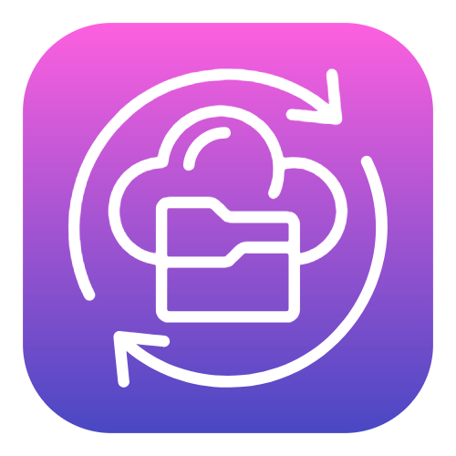
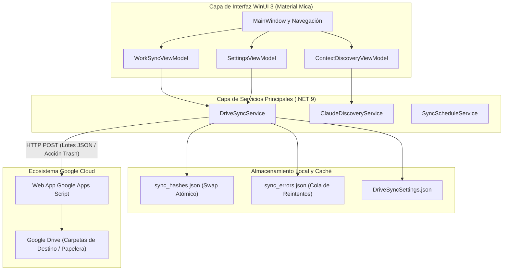

<p align="center">
  
</p>

# Google Drive Work Sync

> **Aplicación de escritorio ligera y de alto rendimiento para Windows, diseñada para la sincronización bidireccional segura de carpetas de trabajo locales y contexto de Claude IA directamente hacia Google Drive mediante Web Apps de Google Apps Script.**

[English](README.md) | [Español](README.es.md)

[-0078D6?style=flat&logo=windows&logoColor=white)](https://microsoft.com)
[](https://dotnet.microsoft.com/)
[](https://learn.microsoft.com/windows/apps/winui/winui3/)
[](https://learn.microsoft.com/windows/apps/winui/winui3/)
[](GoogleDriveWorkSync.Tests/)
[](LICENSE)

---

## Descripción del Proyecto

**Google Drive Work Sync** es una aplicación de escritorio moderna y de alto rendimiento para Windows 11 desarrollada en C# 13 y WinUI 3 no empaquetado (.NET 9). Automatiza la sincronización bidireccional segura de directorios de trabajo y contexto de IA (Claude) directamente hacia Google Drive mediante Web Apps de Google Apps Script, eliminando la necesidad de instalar el cliente pesado de Google Drive o gestionar secretos de cliente OAuth2.

Diseñada con Fluent Design nativo de Windows 11, material translúcido Mica, ejecución en la bandeja del sistema y hashing incremental de alta precisión, Google Drive Work Sync ofrece sincronización en segundo plano fiable, sin telemetría y con seguridad fail-closed concebida para desarrolladores y usuarios avanzados.

---

## Características Principales

### 1. Sincronización Incremental de Archivos de Trabajo
- **Vía Rápida por Metadatos y Verificación SHA-256:** Evita subidas redundantes comprobando primero la fecha de modificación y el tamaño en bytes, calculando el hash criptográfico únicamente cuando los metadatos indican alteraciones.
- **Índice Persistente a Prueba de Caídas:** Almacena el estado de los archivos en `%LOCALAPPDATA%\GoogleDriveWorkSync\Data\sync_hashes.json`. El índice se escribe en un archivo temporal y se intercambia atómicamente una vez por lote, garantizando que un corte de energía o cierre inesperado jamás corrompa los datos.
- **Procesamiento por Lotes Adaptativo:** Agrupa archivos en lotes de hasta 8 elementos o 9 MB sin comprimir (~12 MB en base64) para respetar estrictamente las cuotas de ejecución y tamaño de Google Apps Script.
- **Recuperación Resiliente ante Errores:** Registra fallos transitorios de red (429, 500, 503) en `sync_errors.json` y permite reintentos directos con retroceso exponencial (*exponential backoff*).
- **Cero Omisiones Silenciosas:** Los archivos bloqueados o carpetas sin permisos se reportan como errores en lugar de marcarse como "sin cambios", garantizando fiabilidad absoluta en el estado *Al día*. No se siguen enlaces de directorio (junctions o symlinks).
- **Cancelación Inmediata:** Cancelar una sincronización aborta la petición HTTP en curso de inmediato en lugar de bloquear la interfaz hasta el timeout.

### 2. Conteo Dinámico de Pendientes y Poda de Lista en Tiempo Real
- **Contadores Regresivos en Vivo:** A medida que cada lote completa su subida, el conteo de pendientes decrece en tiempo real sin requerir reescaneos completos del disco.
- **Seguimiento Granular:** Clasifica y decrementa por separado los archivos Nuevos versus los Modificados en tiempo real al finalizar cada elemento.
- **Poda en Memoria de Colecciones:** Implementa poda en bucle invertido (*reverse-loop*) sobre `ObservableCollection<OutOfSyncFile>`, eliminando archivos sincronizados directamente de la vista sin bloqueos en el hilo de UI ni errores de desplazamiento de índices.

### 3. Sugerencias de Eliminación y Reconciliación de Huérfanos en Drive (Carpetas + Claude)
- **Detección No Destructiva de Huérfanos:** Compara `sync_hashes.json` contra el disco local tanto para carpetas de trabajo como para archivos de contexto IA (Claude). Los archivos presentes en el índice que hayan sido eliminados localmente se identifican como candidatos a depuración.
- **Envío a Papelera en O(1):** Resuelve referencias remotas en tiempo constante aprovechando el `FileId` de Google Drive y `LocalFilePath` preservados en cada `HashCacheEntry`.
- **Margen de Seguridad con Papelera Suave:** Envía la acción `action: "trash"` a Google Apps Script ejecutando `setTrashed(true)`. Los archivos pasan a la Papelera de Google Drive con un período de recuperación de 30 días en lugar de borrarse permanentemente.
- **Confirmación Fail-Closed:** Cero eliminaciones automáticas en Drive; cada operación requiere revisión y selección explícita del usuario. Los elementos enviados a papelera se purgan inmediatamente de `sync_hashes.json`.

### 4. Detección Accionable de Duplicados en Tres Capas (Carpetas + Claude)
- **Agrupamiento por Tamaño sin I/O de Disco (Capa 1):** Agrupa archivos locales por tamaño (`GroupBy(f => f.FileSize)` con `FileSize > 0`). Descarta de inmediato los archivos con tamaños únicos sin realizar ninguna lectura en disco.
- **Reutilización de Caché de Hashes (Capa 2):** Consulta `sync_hashes.json` para candidatos con tamaños coincidentes vía `TryGetCachedHash`, reutilizando hashes SHA-256 en memoria sin leer los archivos físicos.
- **Filtro de Cabecera en Microsegundos (Capa 3A):** Lee y calcula el hash de los primeros 16 KB de archivos no cacheados, descartando el 99% de colisiones accidentales de tamaño en microsegundos.
- **SHA-256 de Flujo Completo (Capa 3B):** Ejecuta hashing criptográfico completo únicamente en pares candidatos que comparten tamaño idéntico y cabecera de 16 KB coincidente.
- **Limpieza Accionable con Papelera Segura de Windows:** Permite al usuario seleccionar copias redundantes protegiendo estrictamente la copia canónica original. Las copias seleccionadas se mueven de manera segura a la **Papelera de Reciclaje de Windows** mediante Win32 Shell API (`SHFileOperation` con `FOF_ALLOWUNDO`) y opcionalmente a la Papelera de Google Drive en la misma operación.
- **Cuantificación de Espacio y Atribución Primaria:** Cuantifica el espacio redundante (`(Count - 1) * FileSize`) e identifica el archivo original canónico mediante la fecha de modificación más antigua (`LastModified`).

### 5. Detección y Respaldo de Contexto IA (Claude)
- **Exploración Jerárquica BFS:** Realiza un recorrido en anchura (niveles 1 al 6) por directorios de trabajo, identificando directrices de proyecto (`CLAUDE.md`), habilidades de agentes, prompts de subagentes, hooks y mods (`~/.claude/mods/`).
- **Paridad Total en Duplicados y Huérfanos:** Examina los candidatos descubiertos de Claude con el motor de duplicados en 3 capas y reconcilia respaldos de contexto huérfanos contra el sistema de archivos local.
- **Exclusión de Repositorios Git y Worktrees:** Detecta tanto raíces de repositorios estándar (carpeta `.git`) como worktrees vinculados (archivo `.git`), omitiéndolos para evitar clasificar documentación versionada como archivos sin seguimiento.
- **Filtro de Secretos en Tres Capas:** Defensa en profundidad con nombres en lista negra (`.env`, `credentials.json`, `id_rsa`), escaneo por expresiones regulares en los primeros 64 KB en busca de tokens PAT/SSH/OAuth, y saneamiento estricto de configuraciones MCP.
- **Detección de Seguimiento en Git:** Consultas en lotes de `git ls-files` para distinguir documentación versionada de notas y scratchpads locales.

### 6. Programador Automático Flexible y Bandeja del Sistema
- **Reglas de Programación Personalizadas:** Configura sincronizaciones en segundo plano seleccionando días específicos de la semana y horas exactas de ejecución.
- **Minimización a la Bandeja del Sistema:** Se ejecuta silenciosamente en segundo plano utilizando `H.NotifyIcon.WinUI`, minimizándose al área de notificación.
- **Inicio con Windows:** Integración nativa a través del parámetro `--autostart` para ejecutarse automáticamente al iniciar sesión en Windows.

---

## Arquitectura y Componentes



### Matriz de Responsabilidad de Componentes

| Componente | Capa | Responsabilidad |
| :--- | :--- | :--- |
| `DriveSyncService` | Servicio | Sincronización incremental SHA-256, empaquetado en lotes, detección de huérfanos, detección de duplicados en 3 capas y transporte HTTP con Google Apps Script. |
| `ClaudeDiscoveryService` | Servicio | Descubrimiento de workspaces mediante BFS (niveles 1–6), filtrado de repositorios/worktrees de Git y saneamiento de secretos en 3 capas. |
| `SyncScheduleService` | Servicio | Programación en segundo plano, activaciones periódicas y coordinación de inicio automático en Windows. |
| `WorkSyncViewModel` | ViewModel | Gestión de estado de sincronización de carpetas, decrementos dinámicos de progreso, poda de listas en memoria y flujos de huérfanos y duplicados. |
| `ContextDiscoveryViewModel` | ViewModel | Gestión de estado para el escaneo de contexto de IA, selección de archivos y vistas previas. |
| `SettingsViewModel` | ViewModel | Persistencia de configuración, prueba de conectividad con la Web App, registro de inicio con Windows y limpieza de índices. |
| `MainWindow` y Capa Mica | Vista | Interfaz Fluent Design, material translúcido Mica e integración con la bandeja del sistema mediante `H.NotifyIcon`. |

---

## Stack Tecnológico

- **Plataforma y Lenguaje:** C# 13, .NET 9.0 (`net9.0-windows10.0.26100.0`, WinUI 3 no empaquetado)
- **Framework de UI:** Windows App SDK 2.4 / WinUI 3 con material Mica nativo y Fluent Design System
- **Arquitectura MVVM:** `CommunityToolkit.Mvvm` 8.4.0 (Generadores de código fuente para propiedades observables y comandos)
- **Inyección de Dependencias:** `Microsoft.Extensions.Hosting` 9.0.2 (Servicios desacoplados, ViewModels y ciclo de vida de la ventana)
- **Integración con Bandeja del Sistema:** `H.NotifyIcon.WinUI` 2.1.4
- **Suite de Pruebas:** xUnit 2.5.3 + Moq 4.20.72 (136 pruebas unitarias y de integración)
- **Instalador y Empaquetado:** Inno Setup 6.7 con compresión ultra LZMA2 y registro de inicio automático en Windows

---

## Compilación y Ejecución

### Requisitos Previos
- Windows 11 (compilación 22000+) o Windows 10 (versión 1809+)
- [.NET 9.0 Runtime](https://dotnet.microsoft.com/download/dotnet/9.0) (incluido en el instalador autónomo)

### Instalación Rápida (Instalador Oficial)
1. Descarga `GoogleDriveWorkSync-Setup-v1.4.0.exe` desde la sección de [GitHub Releases](https://github.com/AnaCataVC/google-drive-work-sync/releases).
2. Ejecuta el instalador. Puedes marcar la opción de inicio automático con Windows si lo deseas.
3. Inicia la aplicación desde el Menú Inicio o el Escritorio.

### Compilación desde el Código Fuente

```powershell
# 1. Clonar el repositorio
git clone https://github.com/AnaCataVC/google-drive-work-sync.git
cd google-drive-work-sync

# 2. Restaurar dependencias y ejecutar suite de pruebas automatizadas
dotnet test GoogleDriveWorkSync.Tests/GoogleDriveWorkSync.Tests.csproj

# 3. Compilar en configuración Release
dotnet build GoogleDriveWorkSync/GoogleDriveWorkSync.csproj -c Release

# 4. Publicar versión autónoma para x64
dotnet publish GoogleDriveWorkSync/GoogleDriveWorkSync.csproj -c Release -r win-x64 --self-contained true -o releases/GoogleDriveWorkSync-win-x64

# 5. Compilar instalador con Inno Setup
& "$env:LOCALAPPDATA\Programs\Inno Setup 6\ISCC.exe" installer/GoogleDriveWorkSync.iss
```

---

## Configuración

Dirígete a la pestaña de **Ajustes** en la aplicación:
1. **URL de Google Apps Script:** Introduce la URL del script web desplegado (`https://script.google.com/macros/s/.../exec`).
2. **Token de autenticación:** Introduce el token secreto compartido con el script.
3. **Carpetas de origen:** Agrega las rutas de las carpetas locales a sincronizar y su prefijo de destino en Drive.
4. **Programación automática:** Activa el respaldo desatendido, elige los días deseados y define la hora de ejecución.

---

## Pruebas Automatizadas

El proyecto mantiene una suite de pruebas aislada y rigurosa con **136 pruebas unitarias y de integración automatizadas** con una tasa de éxito del 100%. Las pruebas redirigen todos los archivos de configuración y datos hacia rutas temporales aisladas, ejecutándose en secuencia para evitar alterar el estado real de sincronización.

```powershell
# Ejecutar la suite completa de pruebas
dotnet test GoogleDriveWorkSync.Tests/GoogleDriveWorkSync.Tests.csproj
```

Áreas clave de cobertura:
- `DriveSyncServiceTests`: Hashing incremental SHA-256, evaluación rápida por metadatos, partición en lotes (máximo 8 archivos / 9 MB), políticas de reintento HTTP y persistencia de errores.
- `OrphanReconciliationTests`: Detección de archivos eliminados localmente, resolución de FileId en O(1), cargas útiles para la acción trash y limpieza de índices.
- `DuplicateDetectorTests`: Verificación del algoritmo en 3 capas (agrupamiento por tamaño, reutilización de caché, hash de cabecera de 16 KB y validación criptográfica completa).
- `ClaudeDiscoveryServiceTests`: Traversal BFS de directorios, delimitación de repositorios y worktrees de Git y saneamiento de secretos en 3 niveles.
- `ViewModelTests`: Decrementos dinámicos de conteos pendientes, poda de listas en bucle invertido y seguridad en el hilo de UI.

---

## Decisiones de Arquitectura y Aprendizajes

1. **Detección Algorítmica de Duplicados en Tres Capas:** Transmitir gigabytes de archivos desde el disco para calcular hashes SHA-256 genera saturación severa de I/O y sobrecalentamiento. Al agrupar por tamaño primero (Capa 1), reutilizar hashes cacheados de `sync_hashes.json` en memoria (Capa 2) y hashear únicamente una cabecera de 16 KB (Capa 3A), se descarta más del 99% de archivos no duplicados antes de recurrir al hashing criptográfico completo (Capa 3B).
2. **Reconciliación No Destructiva con Papelera de Drive (`setTrashed(true)`):** La eliminación permanente (`Drive.Files.remove`) es irrevocable y acarrea riesgo de pérdida de datos si una unidad local se desmonta temporalmente o se renombra una carpeta. Enviar a la Papelera de Google Drive otorga un margen de recuperación de 30 días, liberando la estructura activa y purgando de inmediato las claves huérfanas en `sync_hashes.json`.
3. **Poda de Colecciones en Bucle Invertido para Estabilidad en UI:** Modificar una `ObservableCollection` durante una iteración hacia adelante arroja `InvalidOperationException`, y eliminar por índice desplaza los elementos restantes provocando omisiones o excepciones de índice fuera de rango. Recorrer en orden inverso (`Count - 1` hasta 0) permite podar los elementos completados en una única pasada determinista en el hilo de UI sin recrear la colección ni congelar los enlaces visuales.
4. **Índice de Hashes a Prueba de Caídas mediante Swap Atómico:** El estado de sincronización se escribe en un archivo temporal y se intercambia atómicamente (`sync_hashes.json`) una vez por lote. Esto garantiza que una terminación inesperada del proceso o corte de energía jamás deje el índice corrupto o truncado a cero bytes.
5. **Filtro de Secretos Fail-Closed en Tres Niveles:** Modelo de seguridad en profundidad que combina listas negras de nombres (`.env`, `credentials.json`, `id_rsa`), escaneo por regex en los primeros 64 KB para tokens PAT/SSH y saneamiento recursivo de archivos de configuración MCP antes de la sincronización.
6. **Detección de Repositorios y Worktrees Git en BFS:** Traversal en anchura que reconoce raíces de Git (tanto carpetas `.git` como punteros de worktree) para que la documentación de proyectos versionados nunca se catalogue erróneamente como notas sin seguimiento.
7. **Recuperación Resiliente y Cero Omisiones Silenciosas:** Los archivos bloqueados y carpetas sin permisos se reportan como errores explícitos en lugar de marcarse como "sin cambios", preservando confianza total en el estado de telemetría "Al día".

---

## Licencia

Este proyecto está bajo la Licencia MIT. Consulta el archivo [LICENSE](LICENSE) para más detalles.
