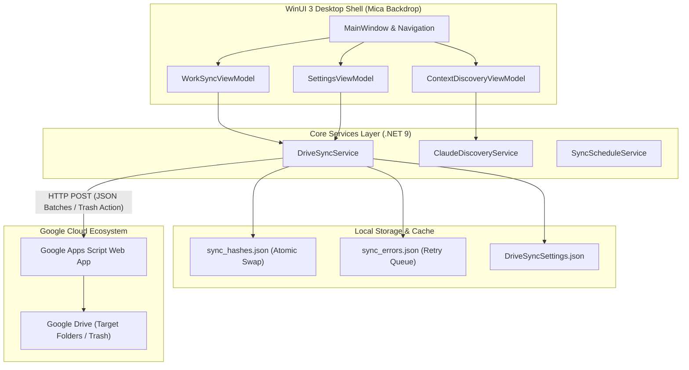

<p align="center">
  
</p>

# Google Drive Work Sync

> **Lightweight, high-performance Windows desktop application for bidirectional-safe synchronization of local work folders and Claude AI context directly to Google Drive via Google Apps Script Web Apps.**

[English](README.md) | [Español](README.es.md)

[-0078D6?style=flat&logo=windows&logoColor=white)](https://microsoft.com)
[](https://dotnet.microsoft.com/)
[](https://learn.microsoft.com/windows/apps/winui/winui3/)
[](https://learn.microsoft.com/windows/apps/winui/winui3/)
[](GoogleDriveWorkSync.Tests/)
[](LICENSE)

---

## Project Overview

**Google Drive Work Sync** is a modern, high-performance Windows 11 desktop application engineered in C# 13 and unpackaged WinUI 3 (.NET 9). It automates bidirectional-safe synchronization of local developer directories and Claude AI contextual knowledge directly to Google Drive via Google Apps Script Web Apps—eliminating the need for bulky full Google Drive client installations or OAuth2 client secrets.

Crafted around native Windows 11 Fluent Design with Mica backdrop materials, system tray minimization, and precision incremental hashing, Google Drive Work Sync provides reliable, zero-telemetry, and fail-closed background synchronization tailored for developers and power users.

---

## Key Features

### 1. Incremental Work File Synchronization
- **Metadata Fast-Path & SHA-256 Verification:** Bypasses redundant uploads by inspecting file modification timestamps and byte sizes first, computing full cryptographic hashes only when metadata indicates modifications.
- **Persistent Crash-Safe Hash Index:** Stores file states in `%LOCALAPPDATA%\GoogleDriveWorkSync\Data\sync_hashes.json`. The index is written to a temporary file and atomically swapped once per batch, ensuring unexpected process aborts or power loss never truncate the database.
- **Adaptive Batching:** Packages files into payloads of up to 8 files or 9 MB uncompressed (~12 MB base64) to strictly comply with Google Apps Script payload and execution limits.
- **Fail-Soft Error Recovery:** Persists transient HTTP failures (429, 500, 503) to `sync_errors.json` and supports single-click batch retries with exponential backoff.
- **Zero Silent Skips:** Unreadable locked files and permission-denied directories are flagged as explicit errors rather than marked as "unchanged", preserving complete integrity in the *Up to date* status. Directory junctions and symlinks are excluded.
- **Responsive Abort:** Cancelling an active synchronization cleanly aborts the in-flight HTTP request immediately rather than blocking until timeout.

### 2. Real-Time Dynamic Pending Sync Count & List Pruning
- **Live Regressive Counters:** As batches complete upload, pending sync counts decrement dynamically in real time rather than waiting for full folder rescans.
- **Granular Classification:** Separately tracks and live-decrements New files vs. Modified files as each item finishes.
- **In-Memory Observable Pruning:** Employs reverse-loop pruning on `ObservableCollection<OutOfSyncFile>` to smoothly remove synchronized items from the UI view in-place without UI thread locks or index shifting errors.

### 3. Google Drive Deletion Suggestions & Orphan Reconciliation (Work Folders + Claude)
- **Non-Destructive Orphan Detection:** Cross-references `sync_hashes.json` against local disk for both monitored work sources and Claude AI context files. Files that existed in the sync index but have since been deleted locally are surfaced as deletion candidates.
- **O(1) Direct Trashing:** Resolves remote file references in constant time via preserved Google Drive `FileId` and `LocalFilePath` inside `HashCacheEntry`.
- **Soft-Trash Safety Buffer:** Dispatches `action: "trash"` to Google Apps Script, executing `setTrashed(true)`. Files are moved to Google Drive Trash with a 30-day recovery buffer rather than permanently deleted.
- **Fail-Closed Confirmation:** Zero automatic remote deletions; every deletion requires explicit human review and selection. Successfully trashed items are purged from `sync_hashes.json`.

### 4. Actionable Multi-Tier Duplicate Detection (Work Folders + Claude)
- **Zero Disk I/O Size Clustering (Tier 1):** Groups local files by size (`GroupBy(f => f.FileSize)` where `FileSize > 0`). Discards all files with unique byte counts instantly with zero disk reads.
- **Hash Cache Reuse (Tier 2):** Checks `sync_hashes.json` for candidates in colliding size buckets via `TryGetCachedHash`, reusing pre-calculated SHA-256 signatures in memory without reading physical files.
- **Microsecond Header Filter (Tier 3A):** Reads and hashes only the first 16 KB of uncached files, eliminating 99% of accidental size collisions in microseconds.
- **Full Stream SHA-256 (Tier 3B):** Executes full cryptographic hashing only on candidate pairs that share both identical file sizes and matching 16 KB headers.
- **Actionable Cleanup with Safe Windows Recycling:** Empowers users to select redundant copies while strictly safeguarding the primary canonical copy. Selected redundant files are safely moved to the **Windows Recycle Bin** via Win32 Shell API (`SHFileOperation` with `FOF_ALLOWUNDO`) and optionally trashed from Google Drive in the same flow.
- **Space Quantification & Primary Attribution:** Quantifies wasted space (`(Count - 1) * FileSize`) and identifies the canonical master copy by earliest `LastModified` timestamp.

### 5. Claude AI Context Discovery & Backup
- **Multi-Level Workspace BFS:** Performs breadth-first traversal (levels 1–6) across developer directories, identifying Claude project instructions (`CLAUDE.md`), agent skills, subagent prompts, hooks, and mods (`~/.claude/mods/`).
- **Full Parity for Duplicates & Orphans:** Scans discovered Claude candidates against the 3-tier duplicate engine and reconciles orphaned remote context backups against local filesystem state.
- **Git Root & Worktree Exclusion:** Traversal detects both standard Git repository roots (`.git` directory) and linked worktrees (`.git` pointer file), skipping them to prevent tracked documentation from being treated as untracked files.
- **Three-Tiered Secret Filter:** Employs a fail-closed defense: blacklisted secret filenames (`.env`, `credentials.json`, `id_rsa`), regex scans across the first 64 KB for PAT/SSH/OAuth tokens, and recursive sanitization of MCP configuration files before sync staging.
- **Git Tracking Awareness:** Batched `git ls-files` queries distinguish versioned documentation from uncommitted local scratchpads.

### 6. Automated Flexible Scheduler & System Tray
- **Custom Schedule Rules:** Configure background synchronization by selecting days of the week and target execution times.
- **System Tray Minimization:** Runs unobtrusively in the background via `H.NotifyIcon.WinUI`, minimizing to the notification area.
- **Windows Autostart:** Seamless integration via `--autostart` command-line switch to launch silently on Windows logon.

---

## Architecture & Component Responsibilities



### Component Responsibility Matrix

| Component | Layer | Responsibility |
| :--- | :--- | :--- |
| `DriveSyncService` | Service | Incremental SHA-256 synchronization, batch packaging, orphan detection, 3-tier duplicate detection, and Google Apps Script HTTP transport. |
| `ClaudeDiscoveryService` | Service | BFS workspace discovery (levels 1–6), git repository/worktree filtering, and 3-tier secret redaction. |
| `SyncScheduleService` | Service | Background cron scheduling, periodic wakeups, and Windows autostart coordination. |
| `WorkSyncViewModel` | ViewModel | State management for folder sync, dynamic progress decrements, in-memory list pruning, and orphan/duplicate workflows. |
| `ContextDiscoveryViewModel` | ViewModel | State management for AI context scanning, file selection, and staging previews. |
| `SettingsViewModel` | ViewModel | Configuration persistence, Web App connection testing, autostart registration, and index clearing. |
| `MainWindow` & Mica Shell | View | Fluent Design navigation shell, Mica backdrop material, and system tray integration via `H.NotifyIcon`. |

---

## Tech Stack

- **Runtime & Language:** C# 13, .NET 9.0 (`net9.0-windows10.0.26100.0`, unpackaged WinUI 3)
- **UI Framework:** Windows App SDK 2.4 / WinUI 3 with native Mica backdrop material and Fluent Design System
- **MVVM Architecture:** `CommunityToolkit.Mvvm` 8.4.0 (Source Generators for Observable Properties & Relay Commands)
- **Dependency Injection:** `Microsoft.Extensions.Hosting` 9.0.2 (Decoupled Services, ViewModels, and Window lifecycle)
- **Tray & Shell Integration:** `H.NotifyIcon.WinUI` 2.1.4
- **Testing Suite:** xUnit 2.5.3 + Moq 4.20.72 (136 unit and integration tests)
- **Installer & Packaging:** Inno Setup 6.7 with LZMA2 ultra compression and automated registry autostart registration

---

## Getting Started

### Prerequisites
- Windows 11 (build 22000+) or Windows 10 (version 1809+)
- [.NET 9.0 Runtime](https://dotnet.microsoft.com/download/dotnet/9.0) (included in the self-contained installer)

### Quick Install (Setup Executable)
1. Download `GoogleDriveWorkSync-Setup-v1.4.0.exe` from the latest [GitHub Releases](https://github.com/AnaCataVC/google-drive-work-sync/releases).
2. Run the installer. You can optionally check "Iniciar Google Drive Work Sync automáticamente al iniciar sesión en Windows".
3. Launch the application from the Start Menu or Desktop.

### Building from Source

```powershell
# 1. Clone repository
git clone https://github.com/AnaCataVC/google-drive-work-sync.git
cd google-drive-work-sync

# 2. Restore dependencies and run automated test suite
dotnet test GoogleDriveWorkSync.Tests/GoogleDriveWorkSync.Tests.csproj

# 3. Build Release binary
dotnet build GoogleDriveWorkSync/GoogleDriveWorkSync.csproj -c Release

# 4. Publish self-contained x64 deployment
dotnet publish GoogleDriveWorkSync/GoogleDriveWorkSync.csproj -c Release -r win-x64 --self-contained true -o releases/GoogleDriveWorkSync-win-x64

# 5. Compile Inno Setup installer
& "$env:LOCALAPPDATA\Programs\Inno Setup 6\ISCC.exe" installer/GoogleDriveWorkSync.iss
```

---

## Configuration

Navigate to **Ajustes** (Settings) in the application:
1. **Google Apps Script URL:** Enter the deployment URL of your Google Apps Script Web App (`https://script.google.com/macros/s/.../exec`).
2. **Authentication Token:** Enter your shared secret token.
3. **Monitored Folders:** Add local folders to synchronize and specify their destination subfolder prefix in Google Drive.
4. **Automated Scheduling:** Toggle background synchronization, choose target weekdays, and set execution time.

---

## Automated Testing

The project maintains a comprehensive, isolated test suite with **136 automated unit and integration tests** achieving a 100% pass rate. Tests redirect all settings files and data directories to sandboxed temporary paths, running sequentially to ensure zero mutation of the live user sync state.

```powershell
# Execute the full test suite
dotnet test GoogleDriveWorkSync.Tests/GoogleDriveWorkSync.Tests.csproj
```

Key test coverage areas include:
- `DriveSyncServiceTests`: Incremental SHA-256 caching, metadata fast-path evaluation, batch splitting (8 files / 9 MB limit), HTTP retry policies, and error persistence.
- `OrphanReconciliationTests`: Detection of locally deleted files, O(1) FileId resolution, soft-trash request payloads, and index cleanup.
- `DuplicateDetectorTests`: 3-tier algorithm verification (size buckets, cache reuse, 16 KB header hashing, and full cryptographic validation).
- `ClaudeDiscoveryServiceTests`: BFS directory tree traversal, Git repository and worktree boundary pruning, and three-tiered secret redaction.
- `ViewModelTests`: Dynamic pending count decrements, reverse-loop list pruning, and UI thread safety.

---

## Key Learnings & Architectural Decisions

1. **Three-Tier Algorithmic Duplicate Detection:** Streaming gigabytes of files from disk to calculate SHA-256 hashes causes heavy disk I/O saturation and thermal throttling. By clustering by size first (Tier 1), reusing cached hashes from `sync_hashes.json` in memory (Tier 2), and hashing only a 16 KB partial header (Tier 3A), over 99% of non-duplicate files are eliminated before performing full cryptographic hashing (Tier 3B).
2. **Non-Destructive Drive Trash Reconciliation (`setTrashed(true)`):** Permanent file deletion (`Drive.Files.remove`) is irrevocable and risks permanent data loss if a local drive is temporarily unmounted or a directory is moved. Soft-trashing safely moves files to Google Drive's Trash bin, providing a 30-day recovery window while freeing up the active folder hierarchy and immediately purging orphaned keys from `sync_hashes.json`.
3. **Reverse-Loop Enumeration Pruning for UI Collection Stability:** Mutating an `ObservableCollection` during forward iteration causes `InvalidOperationException`, and forward index removals shift subsequent indices, leading to skipped elements. Iterating in reverse (`Count - 1` down to 0) enables deterministic single-pass pruning of completed items on the UI thread without re-instantiating the collection or freezing UI bindings.
4. **Crash-Safe Hash Index via Atomic Swap:** Sync state is written to a temporary file and atomically swapped into place (`sync_hashes.json`) once per batch. This ensures that unexpected process termination or power outages never truncate or corrupt the index.
5. **Three-Tiered Fail-Closed Secret Redaction:** Built a defense-in-depth security model combining blacklisted secret filenames (`.env`, `credentials.json`, `id_rsa`), a regex scan across the first 64 KB for PAT/SSH tokens, and recursive sanitization of MCP configuration files before staging.
6. **Nested Git Root & Worktree Detection in BFS:** Implemented a breadth-first search that identifies Git repository roots (both `.git` directories and linked worktree pointer files) so tracked project guidelines are never misclassified as untracked scratch notes.
7. **Fail-Soft Error Recovery & Zero Silent Skips:** Unreadable locked files and permission-denied directories are flagged as explicit errors rather than marked as "unchanged", preserving absolute trust in the "Up to date" telemetry status.

---

## License

This project is licensed under the MIT License. See [LICENSE](LICENSE) for details.
